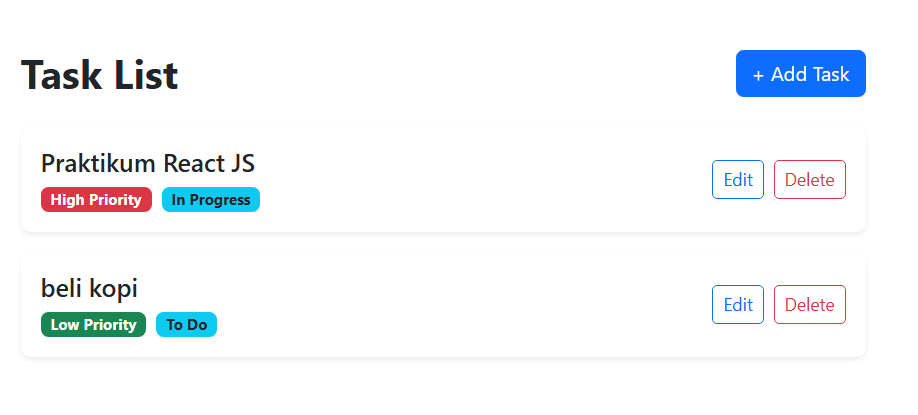

# React 19 TodoList CRUD Application

Aplikasi TodoList interaktif dengan fitur CRUD (Create, Read, Update, Delete) yang dibangun menggunakan React JS (React 19), Vite, dan React-Bootstrap.

## Fitur Utama
- **Create**: Menambahkan kegiatan baru dengan pilihan prioritas (High, Medium, Low) dan status (To Do, In Progress, Done).
- **Read**: Tampilan daftar tugas dengan badge warna visual indikator prioritas (Merah = High, Kuning = Medium, Hijau = Low).
- **Update**: Mengedit nama kegiatan, prioritas, maupun status tugas melalui modal form.
- **Delete**: Menghapus kegiatan dari daftar tugas.

## Tangkapan Layar (Preview)


## Cara Menjalankan Proyek Secara Lokal
1. Clone repositori ini:
   ```bash
   git clone https://github.com/AldianRamadhan/react-todolist-crud.git